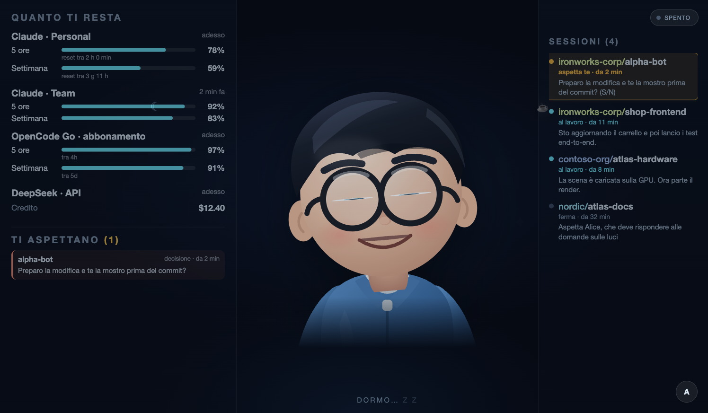

# Ciro — a voice coordinator for your AI coding sessions

Ciro is a talking face that lives in a local web page on your Mac. It keeps an eye on
every Claude Code session you have open, tells you **out loud** when one of them needs a
decision from you, and delivers your spoken answer back to the right session — so the
sessions keep working while you keep your eyes on your own work.

Everything that matters runs on your machine: speech recognition (whisper.cpp), the
voice (Kokoro), the page and the mailbox between sessions. A language model (DeepSeek,
through OpenCode) is used only for free conversation and for matching your saved
preferences; the answer path ("A", "yes", "B for ironworks") never waits for a model.



*Demo data: usage on the left, Ciro in the centre, the open sessions on the right.*

---

## Why

When you run six or seven Claude Code sessions in parallel — each one designing,
writing and testing a different project — the bottleneck becomes you: every session
stops at some point with "Shall I deploy? (Y/N)" or "Option A or B?", and you have to
notice it, switch window, read, answer, switch back.

Ciro removes that friction:

- sessions ask their questions in a **structured** way (fixed options, an ID, a state);
- Ciro **says the question** within a few seconds, wherever you are in the room;
- you answer with **one word** ("A", "yes", "B for alpha-bot");
- the answer is **delivered once**, the session confirms it read it, and only then acts;
- questions already covered by **your own rules** are answered for you, and Ciro tells
  you so in one sentence (you can still say "cancel" or "answer B" within 2 minutes).

---

## What you see

The page has three columns:

| Left column | Centre | Right column |
|---|---|---|
| **How much is left**: usage of your Claude accounts, OpenCode Go and DeepSeek credit | Ciro's face: it moves its mouth with the real audio, sleeps when switched off, and shows subtitles of what you said and what it says | **Sessions**: one card per open Claude Code session, titled `owner/repository`, with its state, how long it has been in that state and a one-line summary |
| **Waiting for you**: the questions that need your answer, oldest first | | Sessions waiting for you go first, with an amber background and a slowly "breathing" border; same owner, same colour |

The right column always fits on screen: with many sessions it shortens the summaries and
then reduces the text size instead of scrolling.

---

## What Ciro does

### Listening and speaking
- Always-on microphone with voice activity detection: no button to press.
- You can **interrupt** Ciro while it speaks: it stops at once and listens.
- Italian voice (Kokoro `im_nicola`), mouth animated on the real sound.
- Written chat as an alternative (the **A** button at the bottom right).
- `S` turns Ciro on and off, `M` toggles the microphone.

### Coordinating the sessions
- **Structured questions** (`posta.py chiedi`): every question has an ID, options
  (A/B/C or S/N), the operation it unlocks and what is blocked until the answer.
- **States**: `ricevuta → in-valutazione → in-attesa → risposta-consegnata → recepita → risolta`
  (received → being evaluated → waiting for you → answer delivered → read by the session → solved),
  plus `annullata` (withdrawn). An answer is delivered **exactly once**; a second delivery or a
  second "read" exits with code 4 and writes nothing, so a session never acts twice.
- **Short answers go only to what Ciro said last.** With two questions open and no project
  named, Ciro asks "Per quale progetto?" ("For which project?") instead of guessing.
- **Corrections**: "annulla" ("cancel") or "rispondi B" ("answer B") within 2 minutes send a
  correction to the session.
- **Your rules**:
  - *work preferences* ("for the Chat spaces use scheme A") are saved by voice; the model
    checks them only when they share words with the question, and waits at most 2 seconds;
  - *test deploys* can be authorised "always, after the tests" for one project — the only
    operation that can ever be authorised;
  - **production deploys, deletions, databases, system configuration, credentials, new
    external services and subscriptions are never answered automatically**, whatever a rule
    or a model says.
- **Credentials**: when a session asks for a secret, a protected field appears on the page.
  The value goes only to the macOS Keychain (`ciro-<project>-<name>`), never to logs, mail,
  Ciro's memory or command-line arguments. The session receives just the Keychain entry name.
- **Summaries** every 30 minutes, only when something happened (sessions restarted,
  questions solved, rules used, questions waiting for more than 30 minutes). Change it by
  voice: "riepilogo ogni ora" ("summary every hour"), "niente riepiloghi" ("no summaries").

### Memory
- General rules you give by voice ("from now on…") are saved in
  `~/.config/opencode/memoria-ciro.md` and shared with OpenCode.
- The conversation survives restarts (`~/.config/faccia/contesto.json`) and is compacted
  automatically when it grows.
- Every exchange is logged in `~/.config/faccia/conversazioni.log` to analyse bugs.

---

## How it works

```
 Claude Code session ──posta.py chiedi──►  ~/.posta-agenti/domande/<ID>.json  (state)
        ▲                                   ~/.posta-agenti/opencode/nuovi/    (message)
        │                                              │
        │ answer (DOMANDA-ID)                          │ every 2 s
        │                                              ▼
 recepita / risolta  ◄──rispondi_domanda──  Ciro server (server.py, 127.0.0.1:8765)
                                               │  coordinatore: rules, forbidden operations
                                               │  cervello: fast answers, model for free talk
                                               ▼
                                         page (faccia.js) ◄──► microphone / speakers
```

The repository has three parts:

| Folder | What it is |
|---|---|
| `ciro/` | the page and its local server (voice, transcription, panels, coordination) |
| `posta/` | the file mailbox shared by the sessions, with the question records and the rules |
| `stato/` | reads the state of the open Claude Code sessions from their local files |

- **`ciro/server.py`** — local HTTP server on `127.0.0.1` only: page, voice synthesis, transcription,
  the panels' data, the question watcher (every 2 s), credentials, summaries.
- **`ciro/cervello.py`** — the brain: fast answers without a model, free conversation through
  `opencode run`, saved rules, context and compaction.
- **`posta/scripts/`** — the file mailbox shared by the sessions: `posta.py` (commands),
  `domande.py` (question records with locked state transitions), `coordinatore.py` (rules and
  authorisations). Standard library only, Python 3.9+.
- **`stato/scripts/claude_stato.py`** — reads the local files Claude Code already writes
  (`~/.claude/sessions`, `~/.claude/projects`) to know which sessions are open, working or
  waiting. No tokens, no network.
- **`ciro/estensione-chrome/`** — optional Chrome extension that reads your usage on claude.ai,
  OpenCode Go and DeepSeek from the pages where you are already logged in.
- **`ciro/barra-stato.py`** — optional Claude Code status line that saves the official usage
  limits for the left panel.

---

## Installation (macOS)

> Ciro is young and was built on one Mac. Reports and contributions that make it work on
> other setups are very welcome.

### 1. Requirements

- macOS on Apple Silicon (tested on macOS 26), a microphone, Google Chrome.
- [Homebrew](https://brew.sh), Python 3.9+ (`/usr/bin/python3` is fine for the mailbox).
- [Claude Code](https://claude.com/claude-code) for the sessions you want to coordinate.
- [OpenCode](https://opencode.ai) with a DeepSeek provider (direct API or OpenCode Go).

```bash
brew install whisper-cpp ffmpeg
```

### 2. Get the code

```bash
git clone https://github.com/mascor/ciro-ai.git
cd ciro-ai
```

### 3. Voice (Kokoro)

```bash
mkdir -p ~/.local/share/kokoro && cd ~/.local/share/kokoro
python3.12 -m venv venv
venv/bin/pip install kokoro-onnx soundfile
# model and voices from the kokoro-onnx releases (github.com/thewh1teagle/kokoro-onnx):
curl -LO https://github.com/thewh1teagle/kokoro-onnx/releases/download/model-files-v1.0/kokoro-v1.0.onnx
curl -LO https://github.com/thewh1teagle/kokoro-onnx/releases/download/model-files-v1.0/voices-v1.0.bin
```

`ciro/avvia.command` starts the server with that interpreter; if you put the virtual
environment elsewhere, set `CIRO_PYTHON=/path/to/python`.

### 4. Transcription (whisper.cpp)

```bash
mkdir -p ~/.local/share/whisper-cpp && cd ~/.local/share/whisper-cpp
curl -LO https://huggingface.co/ggerganov/whisper.cpp/resolve/main/ggml-large-v3-turbo-q5_0.bin
```

### 5. Mailbox

```bash
mkdir -p ~/.posta-agenti/bin
cp posta/scripts/{posta.py,domande.py,coordinatore.py} ~/.posta-agenti/bin/
```

Then add the session rules to your global `~/.claude/CLAUDE.md`, so every Claude Code
session asks its questions with `posta.py chiedi` and acts only after `posta.py recepita`
succeeds. The text to paste is in `posta/REGOLA-CLAUDE.txt` (in Italian, like Ciro).

### 6. Configure

Everything has a default; these environment variables change it:

| Variable | Meaning | Default |
|---|---|---|
| `CIRO_UTENTE` | your first name, so Ciro can address you | none ("the user") |
| `CIRO_NOMI_UTENTE` | names that mean "you" in the sessions' waiting lines, comma separated | `CIRO_UTENTE` |
| `CIRO_PYTHON` | Python with `kokoro-onnx` | `~/.local/share/kokoro/venv/bin/python` |
| `FACCIA_MODELLO` | OpenCode model for free conversation | `deepseek/deepseek-flash` |
| `FACCIA_VELOCITA` | voice speed | `1.1` |
| `FACCIA_PORTA` | local port | `8765` |
| `POSTA_RADICE` | mailbox folder | `~/.posta-agenti` |

In OpenCode, connect DeepSeek with `/connect` — never paste API keys in a chat or a file.

### 7. Start

```bash
CIRO_UTENTE=Mario ./ciro/avvia.command
```

The browser opens `http://127.0.0.1:8765/`: press **Inizia** ("Start") and allow the
microphone. Say "Ciro, mi senti?" ("Ciro, can you hear me?").

### 8. Optional

- **Usage panel**: load `ciro/estensione-chrome/` in every Chrome profile
  (`chrome://extensions` → Developer mode → Load unpacked), and set
  `ciro/barra-stato.py` as the Claude Code `statusLine` in `~/.claude/settings.json`.
- **Account names**: `~/.config/faccia/nomi-account.json` maps an email to a short name,
  e.g. `{"me@example.com": "Personal"}`.

---

## Using it

| You say | Ciro does |
|---|---|
| "A" / "la B" / "sì" / "no" | answers the question it just read, in under a second |
| "B per alpha-bot" | answers that project's question |
| "annulla" / "rispondi B" (within 2 min) | sends a correction for the answer just given |
| "da ora in poi …" ("from now on …") | saves a general rule |
| "da ora chiedimi sempre prima di pubblicare X" | removes the automatic test-deploy rule for X |
| "riepilogo ogni ora" / "niente riepiloghi" | changes the summaries |
| anything else | normal conversation about your sessions and mail |

For a session, a question looks like this:

```bash
python3 ~/.posta-agenti/bin/posta.py chiedi --da ironworks \
  --oggetto "Chat spaces" --domanda "Which scheme for the Chat spaces?" \
  --opzione "A=one space per project" --opzione "B=one space per customer" \
  --raccomanda A --operazione scelta --bloccato "creating the spaces"
# when the answer arrives:
python3 ~/.posta-agenti/bin/posta.py recepita --id <ID> --casella ironworks   # act only if it exits 0
python3 ~/.posta-agenti/bin/posta.py risolta --id <ID>
```

---

## Security

- The server listens on `127.0.0.1` only and refuses requests from other web sites
  (Origin / Sec-Fetch-Site checks, DNS-rebinding protection).
- Forbidden operations are enforced in code (`coordinatore.VIETATE`), not in a prompt.
- Credentials: stdin to `security -i`, never arguments, logs or mail.
- Ciro never confirms production deploys, deletions or database changes: those stay with
  you, in the server session.

---

## Tests

```bash
(cd posta/scripts && python3 -m unittest test_posta test_domande test_coordinatore)
(cd stato/scripts && python3 -m unittest test_claude_stato)
(cd ciro && python3 -m unittest tests.test_coordinamento_ciro tests.test_credenziali \
  tests.test_consumi tests.test_pannello_sessioni)
```

All tests use temporary folders (`POSTA_RADICE`, `CIRO_AUTORIZZAZIONI`, `FACCIA_CONTESTO`) and a
fake model: they never touch your real mailbox, Keychain or sessions.

---

## Roadmap

- **Tablet**: use Ciro away from the desk.
- **3D Ciro**: a half-body character at a desk with monitors showing the real sessions
  (design in `docs/ciro-3d-design.md`).
- **Server agents**: coordinate the agents that run on remote servers, not just the Mac.
- **Portability**: an installer, Linux and Windows.

Issues and pull requests are welcome. The design of the coordination is in
`docs/coordination-design.md`.

## License

MIT — see [LICENSE](LICENSE).

The code and the voice are in Italian; the documentation is in English.
